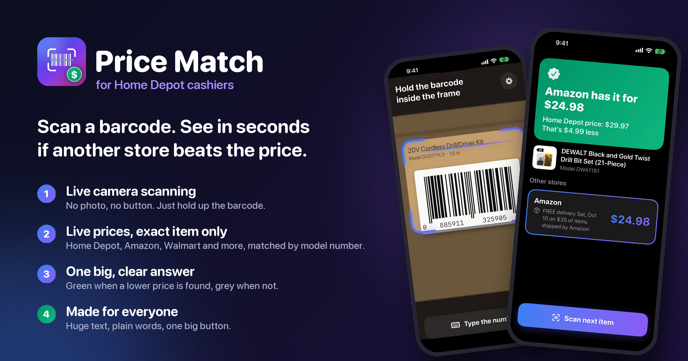
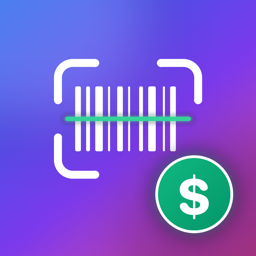
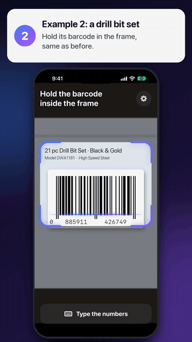
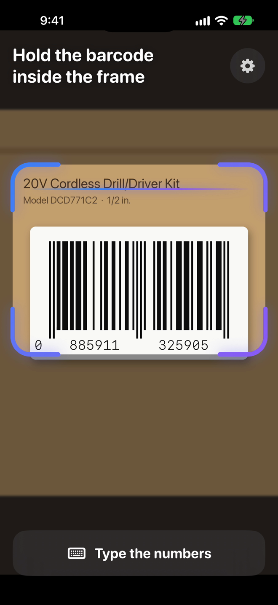
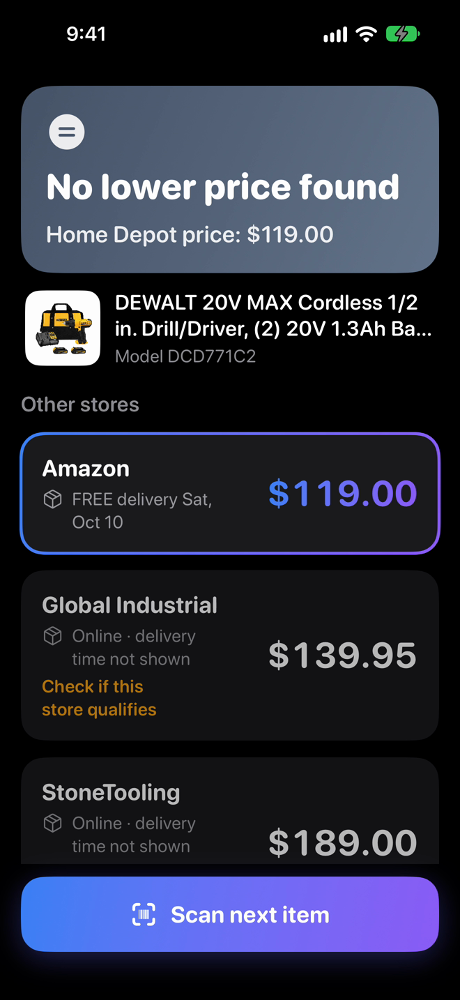
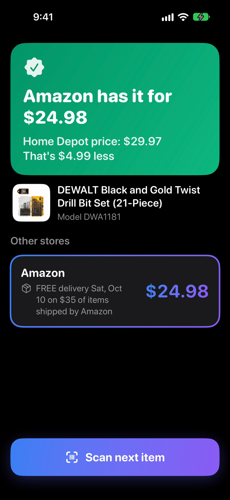
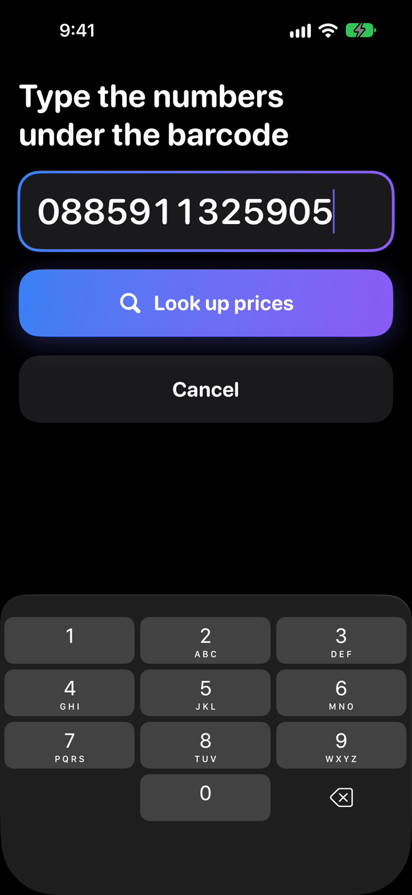
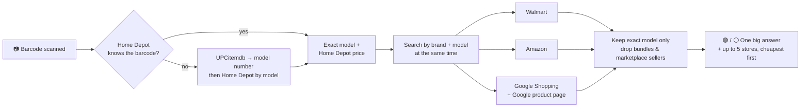

<p align="center">
  
</p>

<h1 align="center">
   Price Match
</h1>

<p align="center">
  <b>An iPhone app for Home Depot cashiers.</b><br>
  Scan an item's barcode with the camera and see, in seconds, whether another store sells the <i>exact same item</i> for less.
</p>

<p align="center">
  
  
  
  
</p>

---

## ▶️ See it in action

<table>
  <tr>
    <td width="40%" align="center">
      <br>
      <sub>Scanning a drill bit set → Amazon is $4.99 cheaper</sub>
    </td>
    <td>
      <h3>🎬 <a href="docs/demo.mp4">Watch the full narrated demo (1:40)</a></h3>
      <p>A step-by-step walkthrough with two real examples and live prices from October 2026:</p>
      <ol>
        <li><b>DeWalt drill (DCD771C2)</b> — Home Depot $119, Amazon $119 → <i>No lower price found</i></li>
        <li><b>DeWalt 21-pc drill bit set (DWA1181)</b> — Home Depot $29.97, Amazon $24.98 → <i>Lower price found</i></li>
      </ol>
      <p><sub>Recorded on the iPhone Simulator, so the camera view is a picture of a real barcode. On an iPhone it's the live camera.</sub></p>
    </td>
  </tr>
</table>

## 📱 Screenshots

| Scan | No lower price | Lower price found | Barcode won't scan? |
|:---:|:---:|:---:|:---:|
|  |  |  |  |
| Hold the barcode in the frame. It scans by itself. | Grey: Home Depot is already the lowest. | Green: the store, its price, and how much less. | Type the number under the barcode instead. |

## ✨ What makes it good at the register

- **📷 Scans live, no photo.** The camera opens straight away; hold up the barcode and it beeps once when it's read.
- **🎯 Exact item only.** A competitor price is only shown if the listing names the *same model number*, with no other model in it. Look-alike models, used items and bundles ("drill + 100-piece bit set") are thrown out.
- **🟢 One big answer.** "Amazon has it for $24.98 — Home Depot price: $29.97 — That's $4.99 less." Green when a lower price exists, grey when not.
- **🏪 Major retailers first.** Lowe's, Menards, Walmart, Amazon, Ace and others are recognised. Marketplace sellers ("Walmart – SomeSeller"), eBay and warehouse clubs are hidden or flagged *"Usually can't be matched"*.
- **🧓 Built for anyone.** Huge rounded text that follows the phone's text size, plain words ("barcode", not "UPC"), one big button per screen, no pop-ups, no menus. Setup hides behind a 2-second press so nobody opens it by accident.
- **🔒 Key kept safe.** The price-service key is stored in the iPhone Keychain, never in the code.

## ⚙️ How it works



| Step | Source (via [SerpApi](https://serpapi.com)) | Why |
|---|---|---|
| Identify the item | Home Depot search **by barcode** | Gives the exact model number and Home Depot's own price in one step |
| Fallback | [UPCitemdb](https://www.upcitemdb.com) (free) | Model number for barcodes Home Depot doesn't recognise (e.g. older packaging) |
| Competitors | Walmart, Amazon, Google Shopping | Searched by brand + model, in parallel |
| Everyone else, incl. Lowe's | Google's product page | Google groups identical items across stores |

> Google Shopping **can't** search by barcode. It returns unrelated products (an umbrella for a drill's barcode). That's why the app always finds the model number first.

## 🚀 Getting started

**You need:** a Mac with Xcode 16+, an iPhone XS or newer on iOS 17+, and a free [SerpApi](https://serpapi.com) key.

1. Open `PriceMatch.xcodeproj` in Xcode.
2. **Signing & Capabilities** → choose your Apple ID as *Team*, and set a unique *Bundle Identifier* (e.g. `com.yourname.pricematch`).
3. Plug in the iPhone, turn on **Developer Mode** (Settings → Privacy & Security), pick it in Xcode and press **▶ Run**.
4. First launch: on the iPhone, trust the developer (Settings → General → VPN & Device Management).
5. **Prices:** either set up the [key server](#-key-server) (recommended, nothing to type on the phone), or in the app tap **"Not set up yet — tap here"** and paste a SerpApi key.

> **Free Apple ID:** the app stops opening after 7 days and needs reinstalling from Xcode. A paid Apple Developer account ($99/yr) removes the limit and allows TestFlight for several phones.

## 🔑 Key server

`server/` is a tiny [Cloudflare Worker](https://developers.cloudflare.com/workers/) that holds the SerpApi key, so the key **never ships inside the app**. The app sends its searches to the Worker, which:

- requires the app's token (`X-App-Token`),
- only allows the 5 searches the app uses (Home Depot, Walmart, Amazon, Google Shopping, Google product page),
- limits each connection to 60 searches a minute,
- caches answers for 15 minutes, so the same item scanned on several phones costs one set of searches.

**Set up (once):**

```bash
cd server
npm install
npx wrangler login
npx wrangler deploy
npx wrangler secret put SERPAPI_KEY   # paste your SerpApi key
openssl rand -hex 32                  # make an app token…
npx wrangler secret put APP_TOKEN     # …and paste it here
```

Then copy `Config/Secrets.example.xcconfig` to `Config/Secrets.xcconfig` (git-ignored) and fill in the Worker's host and the same token. Builds now use the server automatically, and Setup shows *"Connected to the Price Match server"*. Leave the file out to fall back to a key typed into Setup.

> The app token is compiled into the app, so it's a speed bump, not a vault. That's fine for TestFlight to a few people; for a public release, add Apple's App Attest.

## 💲 Costs

| | Free plan | Notes |
|---|---|---|
| SerpApi | 250 searches / month | Each scan uses **4–5 searches** → about **50 scans / month**. Re-scanning the same item within 15 minutes is free. A register needs a paid plan. |
| UPCitemdb | ~100 lookups / day | Only used when Home Depot doesn't recognise a barcode |

## 🗂 Project structure

```
PriceMatch/
├── PriceMatchApp.swift          App entry point
├── ContentView.swift            Camera screen, scan frame, "Type the numbers" keypad
├── ResultsView.swift            The big answer + store cards + "Scan next item"
├── ScannerView.swift            VisionKit DataScannerViewController (live barcode reading)
├── SettingsView.swift           One-time setup: key, store location, options
├── Theme.swift                  Colours, rounded fonts, BigButton
├── Models.swift                 Offer, ProductInfo, plain-language error messages
├── Demo.swift                   Simulator-only demo mode used to record the video (DEBUG builds only)
└── Services/
    ├── PriceLookupService.swift Orchestrates the lookup, caching, sorting
    ├── SerpApiClient.swift      Home Depot, Walmart, Amazon, Google Shopping, Google product page
    ├── ProductMatcher.swift     Exact-model matching and bundle rejection
    ├── CompetitorFilter.swift   Which stores count, plain-words availability
    ├── UPCItemDBClient.swift    Barcode → model fallback
    └── KeychainStore.swift      Stores the API key securely
Config/                          App.xcconfig, Info.plist additions, Secrets.xcconfig (git-ignored)
server/                          Cloudflare Worker key server
docs/                            README images, screenshots and the demo video
```

## 🧭 Known limitations

- **Lowe's** only appears when Google lists Lowe's for that exact item, which is rare; Lowe's blocks apps from reading its website directly.
- **Speed:** a new item takes about 10–14 seconds; a repeat scan is instant.
- **Home Depot's price** is the website price, which can differ from the local shelf price.
- Prices with delivery minimums (e.g. Amazon's free delivery over $35) are shown as listed; the cashier decides.

## ⚖️ Disclaimer

Price Match is an independent project and is **not affiliated with or endorsed by The Home Depot**. It helps a cashier *find* prices; it doesn't decide whether a match is allowed. **Always follow the current Home Depot price match policy.**
